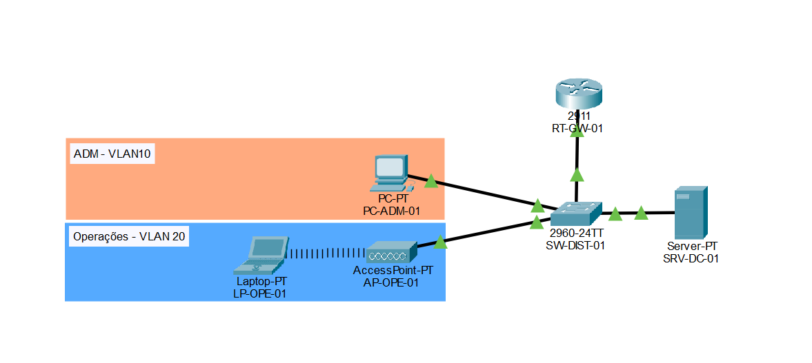
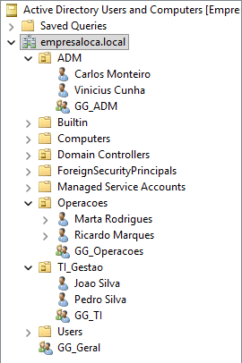
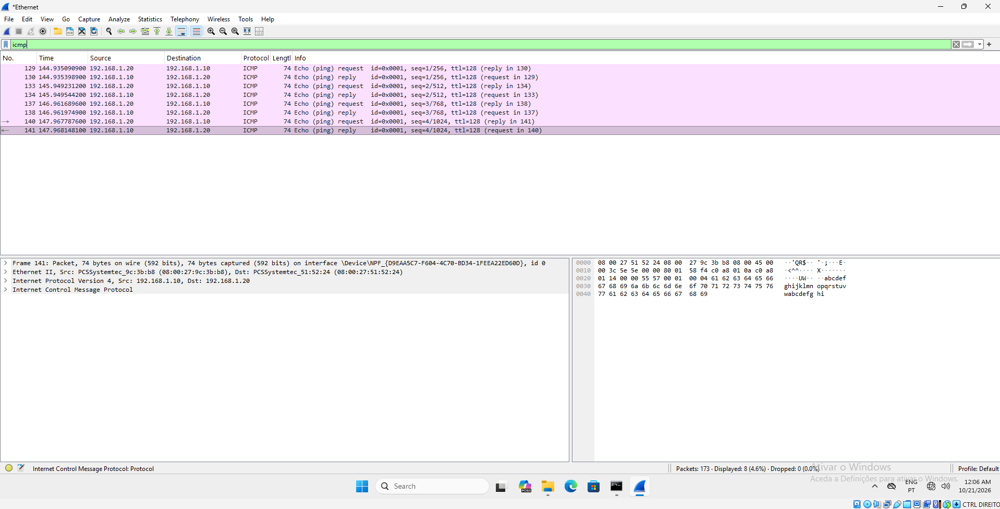

# 🏢 Enterprise Network Homelab & IT Infrastructure

Simulação de uma arquitetura de rede corporativa de pequena/média dimensão, integrando segmentação de redes por VLANs, administração de sistemas (Windows Server) e análise de tráfego de diagnóstico.

---

## 🛠️ Tecnologias Utilizadas
* **Redes:** Cisco Packet Tracer, Routers, Switches, Access Points, TCP/IP, VLANs, DHCP, DNS.
* **Sistemas Operativos:** Windows Server, Windows 11 (Clientes).
* **Virtualização:** VirtualBox.
* **Diagnóstico & Segurança:** Wireshark (Captura e análise de pacotes).

---

## 📐 1. Fase de Redes (Cisco Packet Tracer)
Desenho e implementação da topologia de rede segmentada por departamentos, garantindo isolamento de tráfego e encaminhamento entre redes.

**Resumo das Configurações:**
* **Segmentação por VLANs:** Criação da `VLAN 10` (Administração) e `VLAN 20` (Operações) no Switch.
* **Trunking & Encaminhamento:** Configuração de portas *Trunk* no Switch e subinterfaces no Router (*Router-on-a-Stick*) para o tráfego Inter-VLAN.
* **Wi-Fi Corporativo:** Integração de Access Point para conectividade sem fios dos utilizadores de mobilidade.
* **Hardening Base:** Alteração de credenciais por omissão e atribuição de IP de gestão (`VLAN 99`).

---

## 🖥️ 2. Fase de Servidores & Administração (VirtualBox / Windows Server)
Implementação de um ambiente centralizado de diretório e serviços de rede para suporte e gestão de postos de trabalho.

**Resumo das Configurações:**
* **Active Directory (AD DS):** Promoção do servidor a Domain Controller e criação do domínio local.
* **Gestão de Identidades:** Organização de Unidades Organizacionais (OUs) por departamentos e criação de utilizadores de teste.
* **Serviços de Rede Core:**
  * **DHCP:** Atribuição dinâmica de endereços IP aos clientes da rede.
  * **DNS:** Resolução de nomes interna e encaminhamento de consultas externas.
* **Integração de Clientes:** Junção de máquinas virtuais Windows 11 ao domínio corporativo.

---

## 🔍 3. Fase de Diagnóstico e Auditoria (Wireshark)
Validação do funcionamento dos serviços e análise de pacotes de rede para auditoria e resolução de problemas (*troubleshooting*).

**Resumo dos Testes e Diagnósticos:**
* **Análise do DHCP:** Captura e validação das 4 fases do pedido de IP (*Discover, Offer, Request, Acknowledge*).
* **Diagnóstico DNS:** Inspeção de pedidos de resolução de nomes efetuados pelas máquinas clientes.
* **Conectividade Inter-VLAN:** Validação de tráfego ICMP (*Ping*) e filtragem de pacotes entre os diferentes segmentos da rede.

---
*Projeto desenvolvido por Pedro Henrique Silva no âmbito do CTeSP de Redes e Segurança Informática (IPCA).*
